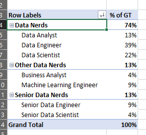
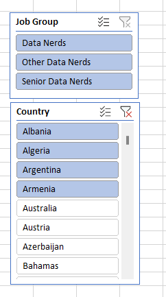
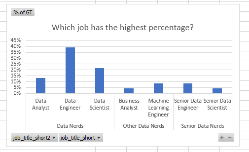

# 📊 Analisis Data dengan Pivot Table & PivotChart

Repository ini berisi file Excel untuk analisis data interaktif menggunakan **PivotTable**, **PivotChart**, dan **filter connection**.  
Tujuan utama adalah menampilkan ringkasan data dinamis berdasarkan **tanggal, negara, dan kelompok pekerjaan**.

---

## 📂 Isi File
- **Pivot Table.xlsx**
  - PivotTable untuk analisis data.
  - Filter connection (Date, Country, Job Group).
  - PivotChart (Line/Bar Chart sesuai kebutuhan analisis).
  - Screenshot data mentah sebagai referensi.

---

## 📂 Sample Raw Data
Data mentah ditampilkan dalam bentuk screenshot agar pembaca memahami struktur sebelum diolah:

> Catatan: Screenshot hanya menampilkan sebagian data. Dataset lengkap tersedia di file Excel.

---

## 🛠️ Fitur Utama
- **PivotTable**
  - Ringkasan otomatis (SUM, COUNT, AVERAGE).
  - Analisis berdasarkan **Date**, **Country**, dan **Job Group**.
  - Drill-down detail data.
  - 

- **Filter Connection**
  - Slicer interaktif untuk Date, Country, Job Group.
  - 

- **PivotChart**
  - Visualisasi interaktif berupa **Line Chart** dan **Bar Chart**.
  - Update otomatis saat filter diubah.
  - 

---

## 📝 Instruksi Penggunaan
1. Buka file **Pivot Table.xlsx**.
2. Gunakan slicer/filter untuk memilih:
   - Rentang tanggal.
   - Negara.
   - Kelompok pekerjaan.
3. Lihat ringkasan di PivotTable.
4. Amati perubahan visualisasi di PivotChart.
   - 

---

## 🎯 Tujuan
- Memberikan gambaran dinamis tentang data berdasarkan filter.
- Memudahkan analisis lintas dimensi (waktu, lokasi, pekerjaan).
- Menyediakan visualisasi interaktif untuk presentasi atau laporan.

---

## 📌 Catatan
- Folder `images/` berisi screenshot hasil analisis (raw data, PivotTable, slicer, PivotChart).
