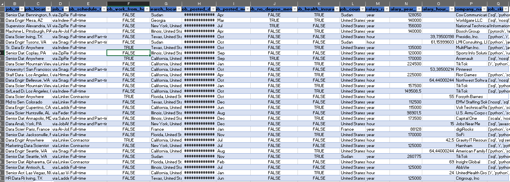
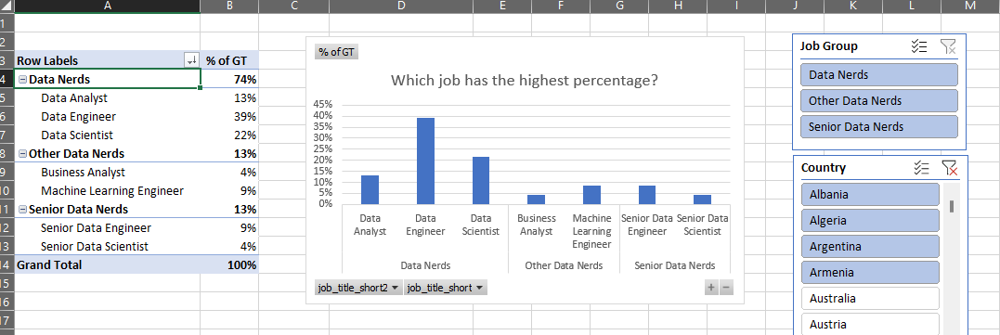

# 📊 Analisis Data dengan Pivot Table & PivotChart

Repository ini berisi file Excel untuk analisis data interaktif menggunakan **PivotTable**, **PivotChart**, dan **filter connection**.  
Tujuan utama adalah menampilkan ringkasan data dinamis berdasarkan **tanggal, negara, dan kelompok pekerjaan**, serta menyediakan berbagai sheet pendukung untuk analisis.

---

## 📂 Isi File
- **Pivot Table.xlsx**
  - **Sheet Data** → berisi data mentah sebagai sumber utama.
  - **Manual Grouping** → pengelompokan data secara manual untuk analisis khusus.
  - **Chart** → visualisasi tambahan berbasis data mentah.
  - **Automatic Grouping** → grouping otomatis berdasarkan kategori tertentu.
  - **Job Count** → perhitungan jumlah pekerjaan.
  - **Monthly_Count_NonPivot** → ringkasan bulanan tanpa PivotTable.
  - **Monthly Count (Pivot)** → ringkasan bulanan menggunakan PivotTable.
  - **Hierarchy** → analisis data dengan struktur hierarki.
  - **PivotTable & PivotChart** → analisis interaktif dengan filter connection (Date, Country, Job Group).
  - Screenshot data mentah & hasil analisis sebagai referensi visual.

---

## 📂 Sample Raw Data
Data mentah ditampilkan dalam bentuk screenshot agar pembaca memahami struktur sebelum diolah:

> Catatan: Screenshot hanya menampilkan sebagian data. Dataset lengkap tersedia di file Excel.

---

## 🛠️ Fitur Utama
- **PivotTable**
  - Ringkasan otomatis (SUM, COUNT, AVERAGE).
  - Analisis berdasarkan **Date**, **Country**, dan **Job Group**.
  - Drill-down detail data.

- **Filter Connection**
  - Slicer interaktif untuk Date, Country, Job Group.

- **PivotChart**
  - Visualisasi interaktif berupa **Line Chart** dan **Bar Chart**.
  - Update otomatis saat filter diubah.

- **Manual & Automatic Grouping**
  - Membandingkan hasil grouping manual vs grouping otomatis.

- **Job Count & Monthly Count**
  - Perhitungan jumlah pekerjaan.
  - Ringkasan bulanan baik dengan Pivot maupun non-Pivot.

- **Hierarchy**
  - Analisis data dengan struktur bertingkat untuk insight lebih dalam.

---

## 📝 Instruksi Penggunaan
1. Buka file **Pivot Table.xlsx**.
2. Gunakan slicer/filter untuk memilih:
   - Rentang tanggal.
   - Negara.
   - Kelompok pekerjaan.
3. Lihat ringkasan di PivotTable.
4. Amati perubahan visualisasi di PivotChart.
   - 
5. Bandingkan hasil analisis di sheet tambahan (Manual Grouping, Monthly Count, Hierarchy).

---

## 🎯 Tujuan
- Memberikan gambaran dinamis tentang data berdasarkan filter.
- Memudahkan analisis lintas dimensi (waktu, lokasi, pekerjaan).
- Menyediakan visualisasi interaktif untuk presentasi atau laporan.
- Menunjukkan perbedaan hasil analisis antara grouping manual, grouping otomatis, dan PivotTable.

---

## 📌 Catatan
- Folder `images/` berisi screenshot hasil analisis (raw data, PivotTable, slicer, PivotChart, grouping, hierarchy).
- Pastikan nama file gambar sesuai dengan yang dipanggil di README agar link tidak rusak.
